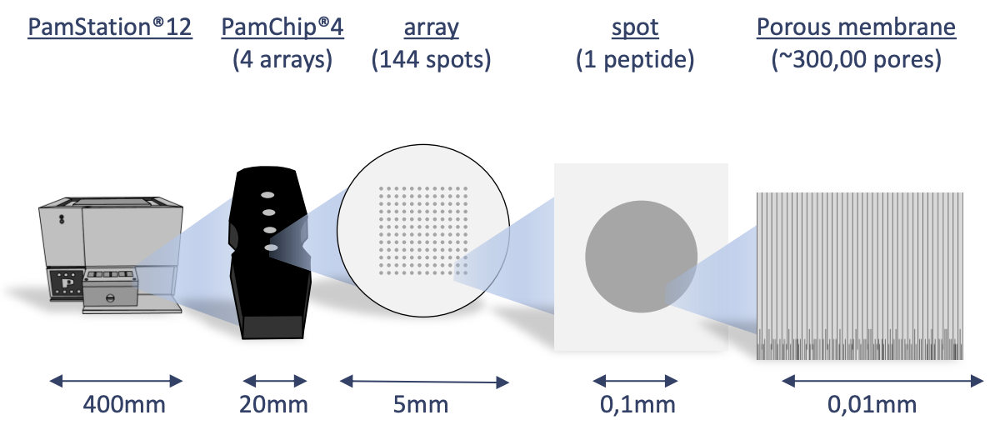
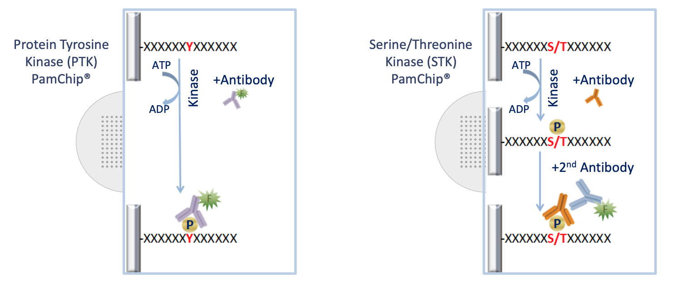

```{r}
#| label: "setup"
#| include: FALSE
if (!is.null(params[["figure_output"]])) dir.create(params[["figure_output"]])
library(KRSA)
library(knitr)
library(tidyverse)

library(gt) # nolint: unused_import_linter.
library(furrr) # nolint: unused_import_linter.

knitr::opts_chunk$set( # nolint: extraction_operator_linter.
  collapse = TRUE,
  comment = "#>",
  cache = FALSE,
  echo = FALSE,
  message = FALSE,
  warning = FALSE
)


# Modify the prefix if pairwise

prefix <- params[["prefix"]]

if (params[["pairwise"]]) {
  prefix <- str_c(prefix, "p-w", sep = "_")
}

# Load into separate environments to avoid overwriting other objects
mapping_env <- new.env()
coverage_env <- new.env()

mapping_names <- load(
  "reference_data/KRSA_Mapping_STK_PamChip_87202_v1.rda",
  envir = mapping_env
)

coverage_names <- load(
  "reference_data/KRSA_coverage_STK_PamChip_87202_v1.rda",
  envir = coverage_env
)

stopifnot(
  length(mapping_names) == 1L,
  length(coverage_names) == 1L
)

new_mapping <- mapping_env[[mapping_names[[1]]]]
new_coverage <- coverage_env[[coverage_names[[1]]]]

```

# Introduction

## Background

The Pamstation12 instrument provides a profiling of kinase activity of cell or tissue samples. The device is loaded with either serine/threonine or tyrosine microarray chips. Each chip has 4 wells, so four samples can be loaded on a single chip, and the Pamstation12 can accommodate 3 chips per run. The microarray represents 144 (STK chip) or 196 (PTK chip) reporter peptides that can be phosphorylated by serine/threonine or tyrosine kinases. The device measures the degree of the phosphorylation in real time by detecting fluorescent labeled antibodies at different exposure times. The list of peptides present in each microarray can be viewed here: [STK chip](https://pamgene.com/wp-content/uploads/2020/09/STK-144-PamChip-87102.pdf), [PTK chip](https://pamgene.com/wp-content/uploads/2020/09/PTK-196-PamChip-86402.pdf)

\newpage

{fig-align="center"}

{fig-align="center"}

# Run Design

Designing the placement of the samples on the chips and arrays is important to consider due to the variability across different chips and batches. During the run some wells are subject to fail and their data cannot be analyzed and shown below as red.

```{r}
#| label: "design"
#| fig-width: 4
#| fig-height: 4

tt <- tibble(
  num = rep(c(3.5, 2.5, 1.5, 0.5), 3L),
  chips = rep(c(2L, 5L, 8L), each = 4L),
  colr = c(rep(1L, 12L)),
  nms = rep(LETTERS[1L:4L], 3L)
)
rundes <- ggplot() +
  geom_rect(aes(xmin = 1L, xmax = 3L, ymin = 0L, ymax = 4L), fill = "gray30") +
  geom_rect(aes(xmin = 4L, xmax = 6L, ymin = 0L, ymax = 4L), fill = "gray30") +
  geom_rect(aes(xmin = 7L, xmax = 9L, ymin = 0L, ymax = 4L), fill = "gray30") +
  xlim(0L, 10L) +
  theme_void()

rundes + geom_point(
  data = tt, aes(chips, num, color = factor(colr)),
  size = 13L, show.legend = FALSE
) +
  geom_text(data = tt, aes(chips, num, label = nms), size = 1.6) +
  scale_color_manual(values = c("green3", "red3"))
```

# Results

## Image Analysis

The first step of analyzing the run is to convert the images taken by the PamStation of each array at different exposure times to numerical values. This is done by the Bionavigator software developed by PamGene. The software recognizes the grid of the array with the aid of the searching algorithm (Pamgrid) to correctly identify each spot on the array. The numbers produced by this software represent the median value of the foreground pixels minus the median value of the background pixels to produce the median signal minus background (Median_SigmBg).

## Reading Data

The first step will be reading the crosstab view bionavigator files (Median_SigmBg and Signal_Saturation) and defining the PamChip type (STK or PTK). The raw data is read and then transformed to be in tidy format for an easier analysis, modeling, and visualizing.

```{r}
#| label: "read-data"

run_prefix <- prefix

chipType <- params[["chip_type"]]

# Read crosstab view bionavigator files and tidy data
raw_data <- krsa_read(
  signal_file = params[["signal_file"]],
  signal_saturation = params[["saturation_file"]]
)
```

## QC Initial Steps and Groups Assignments

We will perform a couple of quality control steps to deal with negative values in the data and adjust based on signal saturation (optional). Next, we will define a new column to represent the grouping. And then, we will extract end point signal values


```{r exposure-qc-child, results='asis'}
cat(
  knitr::knit_child(
    "_exposure_qc_body.Rmd",
    envir = environment(),
    quiet = TRUE
  ),
  sep = "\n"
)
```

```{r select-exposure-qc, include=FALSE}
# Select the branch fitted with observed exposures through 50 ms.
# Low-signal filtering uses predicted 100-ms signals.
selected_qc <- filters_extrapolated_100

# Supply the objects expected by the remaining parent and comparison code.
qc_data <- selected_qc$data_branch
data_pw_max <- selected_qc$data_pw_max
data_pw <- selected_qc$data_pw

high_peptides <- selected_qc$high_peptides
data_modeled <- selected_qc$data_modeled
linear_peptides <- selected_qc$linear_peptides
clean_peptides <- selected_qc$clean_peptides

groups <- unique(as.character(qc_data$Group))

# Verify that observed 100-ms measurements are excluded.
stopifnot(
  selected_qc$max_exposure == corrected_max_exposure,
  selected_qc$target_exposure == original_max_exposure,
  all(qc_data$ExposureTime <= corrected_max_exposure),
  setequal(groups, included_groups)
)

```
## Global Signal Intensity

For a global signal intensity across all samples/groups, few figures can be plotted based on the *Slope_Transformed* values.

### Global CV Plots

We will plot the coefficient of variation on both the normal and normalized fits. This will help us to identify groups with high variation that could be explained by sample outliers.

```{r}
#| label: "global-cv-plot"
#| fig-width: 6
#| fig-height: 6
#| fig-cap: "Coefficient of Variation plotted for each peptide across all 4 groups"
#| eval: !expr params$pairwise
if(!is.null(params[["figure_output"]])) dir.create(params[["figure_output"]])
# Plot a CV figure using the modeled normalized data
if (!is.null(params[["figure_output"]])) {
  krsa_cv_plot(data_modeled[["normalized"]], clean_peptides) |> ggsave(filename=paste(params[["figure_output"]], "cv_plot.pdf", sep="/"))
  } else {
  krsa_cv_plot(data_modeled[["normalized"]], clean_peptides)
  }

```

### Global Violin Plots

We will plot violin figures to examine global signal differences between groups/samples.

```{r}
#| label: "global-violin-plot-by-group"
#| fig-width: 6
#| fig-height: 6
#| fig-cap: "Violin Plots for signal intensity Distribution Across Groups for all replicates"

# Plot a violin figure and facet by the (Group) variable

if (!is.null(params[["figure_output"]])) {
  krsa_violin_plot(data_modeled[["scaled"]], clean_peptides, "Group") |> ggsave(filename=paste(params[["figure_output"]], "violin_plot_bygroup.pdf", sep="/"))
  } else {
  krsa_violin_plot(data_modeled[["scaled"]], clean_peptides, "Group")
  }

```

```{r}
#| label: "global-violin-plot-by-chip"
#| fig-width: 6
#| fig-height: 6
#| fig-cap: "Violin Plots for signal intensity Distribution Across Chips for all replicates"

# Plot a violin figure and facet by the (Barcode) variable
if (!is.null(params[["figure_output"]])) {
  krsa_violin_plot(data_modeled[["scaled"]], clean_peptides, "Barcode") |> ggsave(filename=paste(params[["figure_output"]], "violin_plot_bybarcode.pdf", sep="/"))
  } else {
  krsa_violin_plot(data_modeled[["scaled"]], clean_peptides, "Barcode")
  }

```

### Global Heatmaps

The heatmap represent all the peptides present on the chip except the positive/internal controls and peptides that failed to pass QC. The heatmaps are scaled by row to highlight the peptide signal differences across the samples. A hierarchical unsupervised clustering is applied both on the peptides and the samples to group potentially similar signatures.

```{r}
#| label: "global-signal-heatmap-individual"
#| fig-cap: "Row and chip normalized intensity values for the selected peptides"
#| fig-height: 6
#| fig-width: 6

# Generates a heatmap using the modeled normalized data
nheatmap <- krsa_heatmap(data_modeled[["normalized"]], clean_peptides, scale = "row")
if (!is.null(params[["figure_output"]])) {
  graphics.off()
  pdf(file = paste(params[["figure_output"]], "normalized_heatmap.pdf", sep="/"))
  grid::grid.newpage()
  grid::grid.draw(nheatmap$gtable)
  dev.off()
} else {
  grid::grid.newpage()
  grid::grid.draw(nheatmap$gtable)
}

```

```{r}
#| label: "global-signal-heatmap-grouped"
#| fig-cap: "Row and group normalized intensity values for the selected peptides"
#| fig-height: 6
#| fig-width: 6

# Generates a heatmap using the modeled grouped data
gheatmap <- krsa_heatmap_grouped(data_modeled[["grouped"]], clean_peptides, scale = "row")
if (!is.null(params[["figure_output"]])) {
  graphics.off()
  pdf(file = paste(params[["figure_output"]], "normalized_grouped_heatmap.pdf", sep="/"))
  grid::grid.newpage()
  grid::grid.draw(gheatmap$gtable)
  dev.off()
} else {
  grid::grid.newpage()
  grid::grid.draw(gheatmap$gtable)
}
```

## Group Comparison

Group comparisons use the corrected QC branch. Low-signal filtering
requires predicted 100-ms signal ≥5, while exposure-response linearity
requires R² ≥0.8 using observed measurements through 50 ms.

The comparisons defined below determine the direction of each
fold-change calculation. Differences in modeled kinase-array peptide
signals are evaluated using the specified log₂ fold-change cutoffs.
Peptides exceeding these cutoffs are considered candidate differential
peptides; this classification does not establish statistical significance.

The filtering criteria are:

- Predicted 100-ms signal ≥5, estimated from observed exposures through 50 ms.
- Exposure-response model R² ≥0.8, evaluated using those observed measurements.
- Absolute log₂ fold-change cutoffs of 0.2, 0.3, and 0.4.

```{r}
#| label: "group-comp-list"

# You can define the comparison groups here.
# The group names are in the `groups` variable and you can use subscripting to select the groups
# For example, to compare the first and fourth groups, you can use `groups[1]` and `groups[4]`
# Then copy the next block as many times as there are comparisons and change the `COMP1` to `COMP2`, `COMP3`, etc.
# Also make sure that the label is unique for each block

# Define Groups to be compared
# First group = case; second group = control.

comparisons <- list(
  COMP1 = c(groups[[1L]], groups[[2L]]),
  COMP2 = c(groups[[3L]], groups[[4L]])
)
```


```{r}
#| results: "asis"
#| echo: FALSE
#| include: TRUE
#| label: "childA"
#| fig-width: 6
#| fig-height: 6
#| fig-cap: "Heatmap of pairwise group comparison"

case <- comparisons[["COMP1"]][[1L]]
ctrl <- comparisons[["COMP1"]][[2L]]
random <- "A"
threshold <- params[["threshold"]]

src <- knitr::knit_expand(
  file = "_comparison.Rmd",
  case = case, ctrl = ctrl, threshold = threshold,
  figure_output = params[["figure_output"]],
  chip = params[["chip_type"]]
)

res <- knitr::knit_child(text = src, quiet = TRUE)

cat(res, sep = "\n")
```


```{r}
#| results: "asis"
#| echo: FALSE
#| include: TRUE
#| label: "childB"
#| fig-width: 6
#| fig-height: 6
#| fig-cap: "Heatmap of pairwise group comparison"

case <- comparisons[["COMP2"]][[1L]]
ctrl <- comparisons[["COMP2"]][[2L]]
random <- "B"
threshold <- params[["threshold"]]

src <- knitr::knit_expand(
  file = "_comparison.Rmd",
  case = case, ctrl = ctrl, threshold = threshold,
  figure_output = params[["figure_output"]],
  chip = params[["chip_type"]]
)

res <- knitr::knit_child(text = src, quiet = TRUE)

cat(res, sep = "\n")
```


# Session Info

```{r session_info}
devtools::session_info()
```

